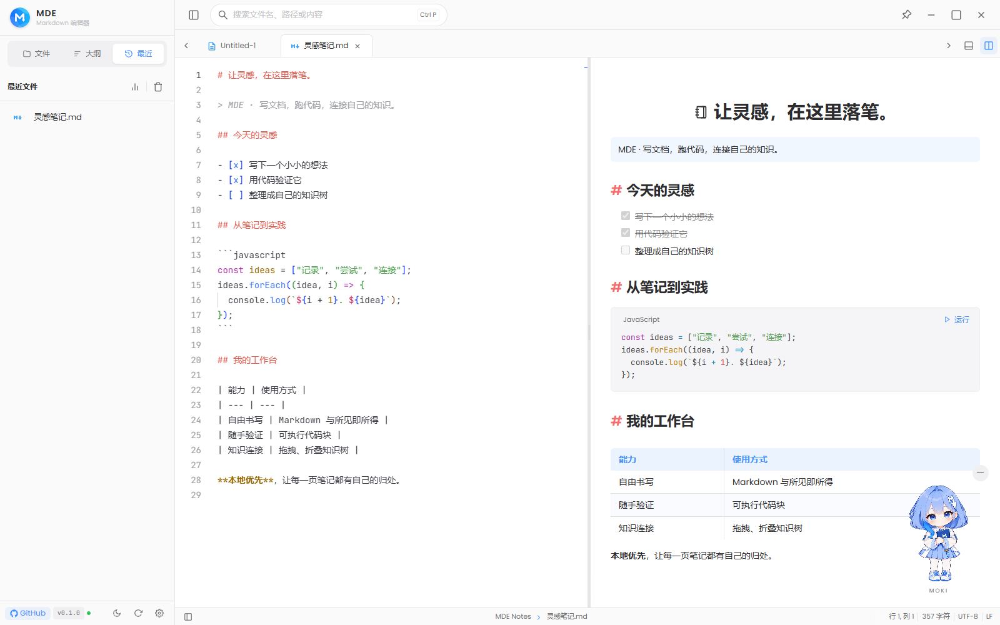
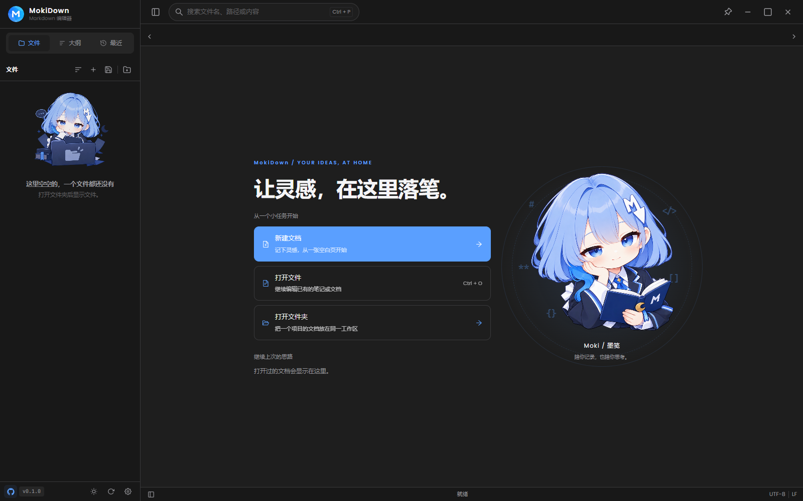
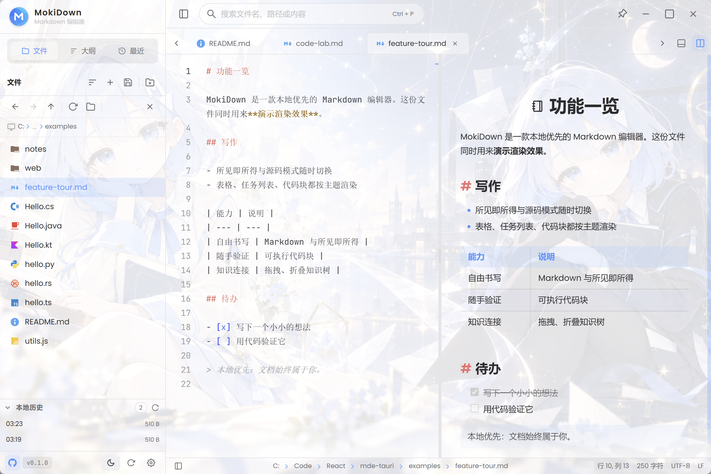
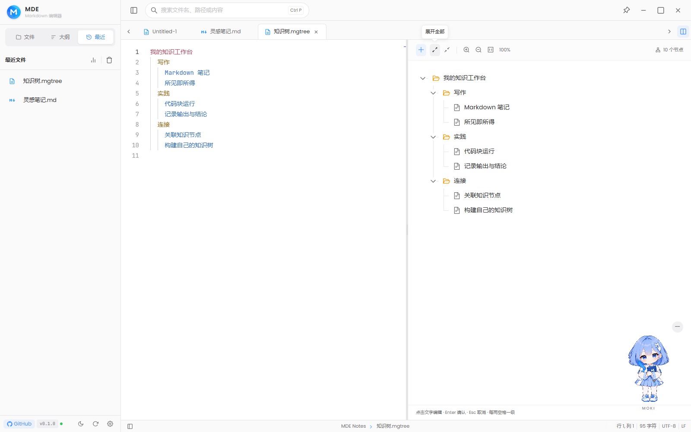
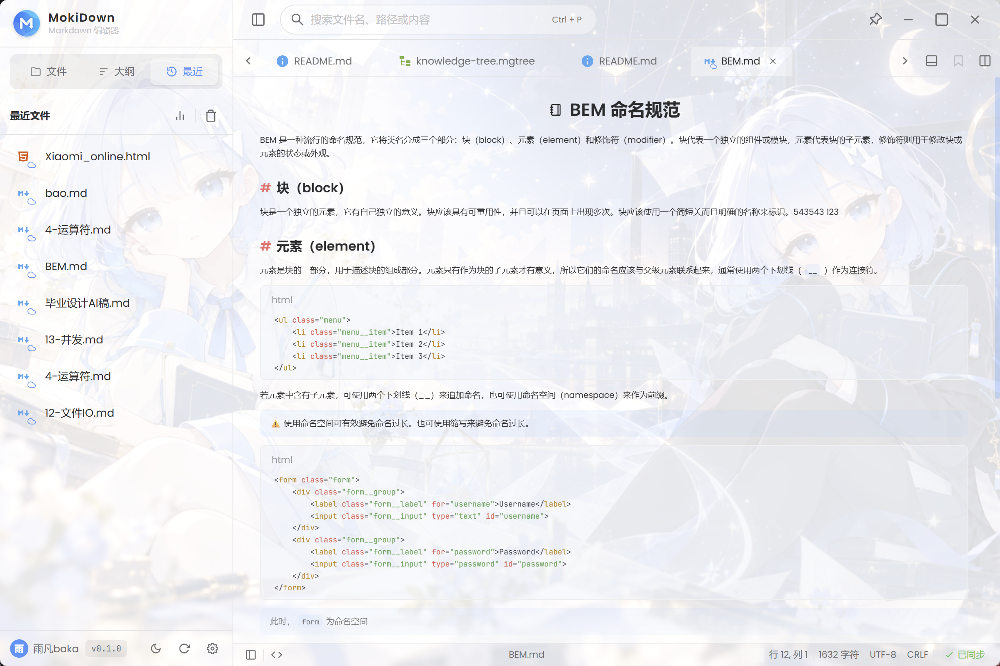
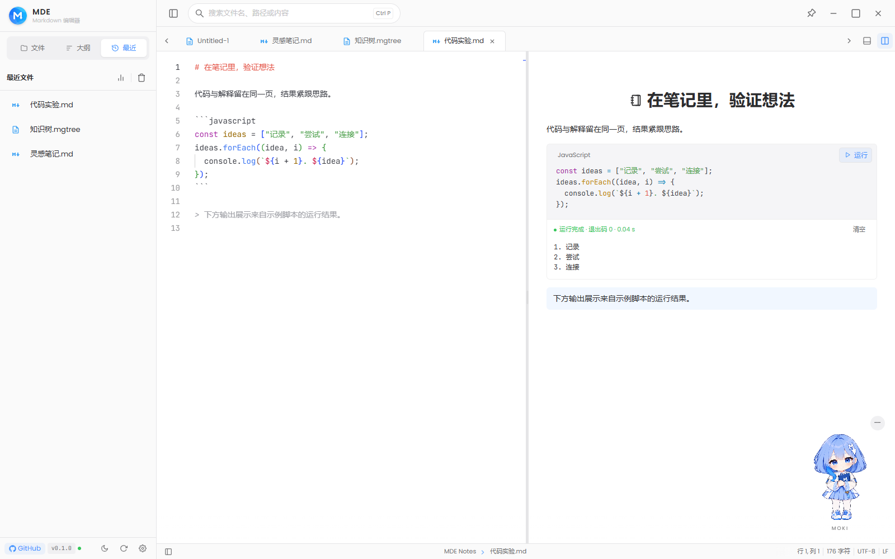
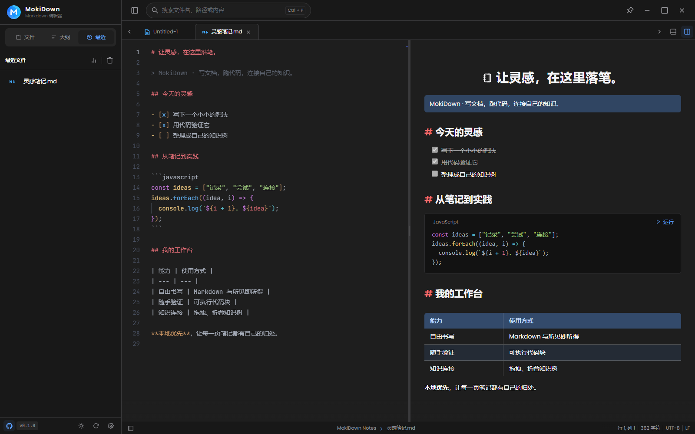
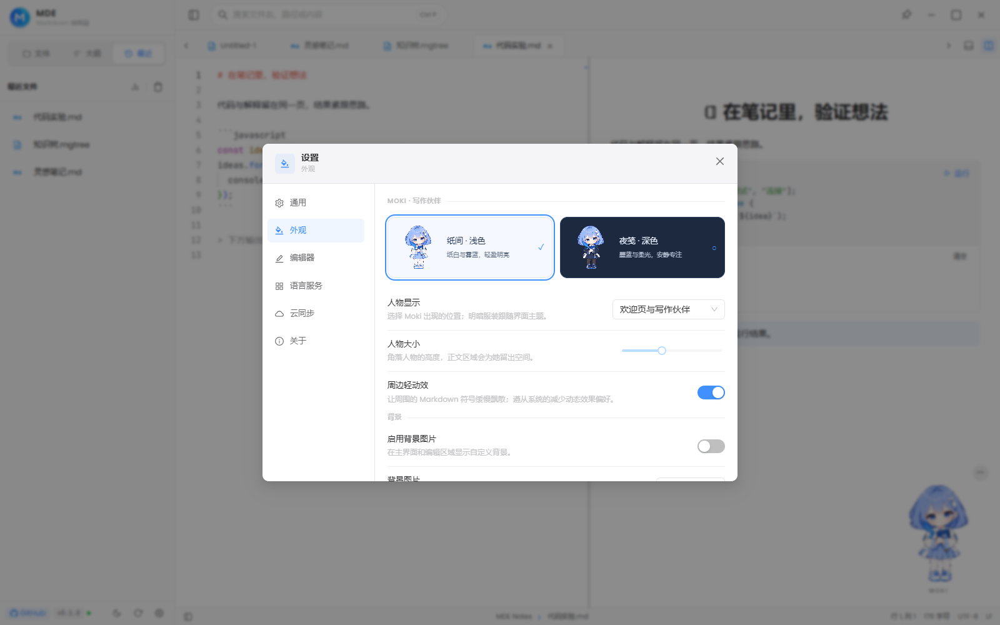

<p align="center">
  
</p>

<h1 align="center">MokiDown</h1>

<p align="center">本地优先的 Markdown 工作台，让写作、代码与知识整理融为一体。</p>

<p align="center">
  <a href="LICENSE"></a>
  
  
</p>

<p align="center">
  <a href="https://www.miaogu.xyz/">在线体验</a> ·
  <a href="https://github.com/hhyufan/mde-tauri/releases">下载</a> ·
  <a href="#-界面截图">截图演示</a> ·
  <a href="#快速开始">快速开始</a> ·
  <a href="docs/Function/README.md">功能文档</a> ·
  <a href="README_EN.md">English</a>
</p>

## 简介

MokiDown 是基于 Tauri 2、React、Monaco 与 Milkdown 的开源 Markdown 编辑器。默认读写本地文件，无需登录；也可连接自托管服务端，同步文档与设置。

<p align="center">
  
</p>

## 功能

* **三种编辑模式**：源码、所见即所得与分屏，支持 GFM、LaTeX 公式和 Mermaid 图表。

* **可执行代码块**：桌面端可运行 C#、JavaScript、Python、Java、Kotlin、Rust，支持输出、交互输入与停止；需安装对应语言环境。

* **语言服务**：按需安装 LSP 插件，提供代码补全、悬停提示与诊断。

* **知识树**：用 `.mgtree` 整理笔记层级，支持节点编辑与跳转到文档代码块。

* **文件与工作区**：多标签页、目录浏览、大纲、全局搜索、书签与自动保存。

* **可选云同步**：同步文档与设置，发生冲突时可对比并选择保留版本。

* **个性化**：支持明暗主题与中英双语界面。

## 📸 界面截图

|                晴笺 · 浅色欢迎页               |               夜读 · 深色欢迎页               |
| :-------------------------------------: | :------------------------------------: |
|  |  |

|     三模式编辑（源码 / WYSIWYG / 分屏）     |          树编辑器（mgtree）         |
| :------------------------------: | :---------------------------: |
|  |  |

|                  云同步                  |                代码块运行               |
| :-----------------------------------: | :--------------------------------: |
|  |  |

|                 深色编辑                 |                 外观与角色设置                |
| :----------------------------------: | :------------------------------------: |
|  |  |

截图来自运行中的实际界面，使用示例文档；代码输出和同步冲突使用演示数据展示真实组件，不代表浏览器可启动桌面执行引擎或已连接同步服务。[移动端欢迎页](screenshots/welcome-mobile.png) · [设计与截图说明](docs/character-design/moki-integration.md)

## 安装

前往 [Releases](https://github.com/hhyufan/mde-tauri/releases) 查看可用安装包，Windows 推荐 EXE（NSIS），也可使用 MSI。其他平台的安装包以发布页实际提供为准。

[在线体验](https://www.miaogu.xyz/) 可免安装查看界面；浏览器演示不具备桌面端的本地代码执行能力。Android 的文件访问与本地脚本运行等能力也有差异。

## 快速开始

### 本地开发

准备 Node.js（推荐与 CI 一致的 22）、Rust 稳定版及对应平台的 Tauri 构建依赖。Windows 还需 MSVC C++ 工具链、Windows SDK 与 WebView2。

在仓库根目录执行：


```bash
npm ci --legacy-peer-deps
npm run tauri:dev
```

仅调试前端可运行 `npm run dev`。常用命令：

| 命令                    | 用途                         |
| --------------------- | -------------------------- |
| `npm run build`       | 构建前端与在线展示入口                |
| `npm run tauri:build` | 打包 Windows 桌面端（React 安装器）  |
| `npm run check`       | 执行 lint、测试、构建与体积检查         |

桌面安装包输出到 `src-tauri/target/release/react/`。示例文档与代码见 [examples](examples/README.md)。

### Android 构建

安装 Android Studio（SDK / NDK / Build Tools）和 JDK 17–21，配置 `JAVA_HOME` 与 `ANDROID_HOME` 后执行：

```bash
npm run tauri:android:init
npm run tauri:android:build
```

### 自托管同步

按 [mde-server](https://github.com/hhyufan/mde-server) 的说明部署服务端，在客户端「设置 → 云同步」中配置服务端地址，登录并绑定文档后启用同步。

## 文档与贡献

* [功能文档](docs/Function/README.md) · [语言服务](docs/语言服务.md) · [本地脚本运行](docs/本地脚本运行.md)

* [示例工作区](examples/README.md) · [快捷键](examples/notes/shortcuts.md) · [更多截图](screenshots/)

* 欢迎通过 [Issues](https://github.com/hhyufan/mde-tauri/issues) 反馈问题或提交 Pull Request。

本项目采用 [MIT 许可证](LICENSE)。

