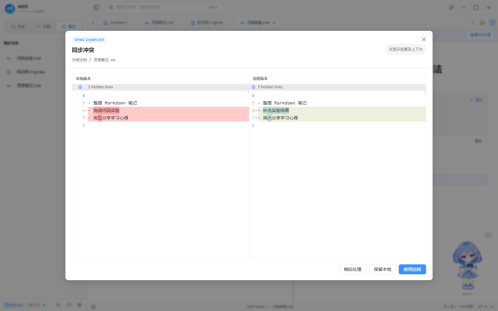
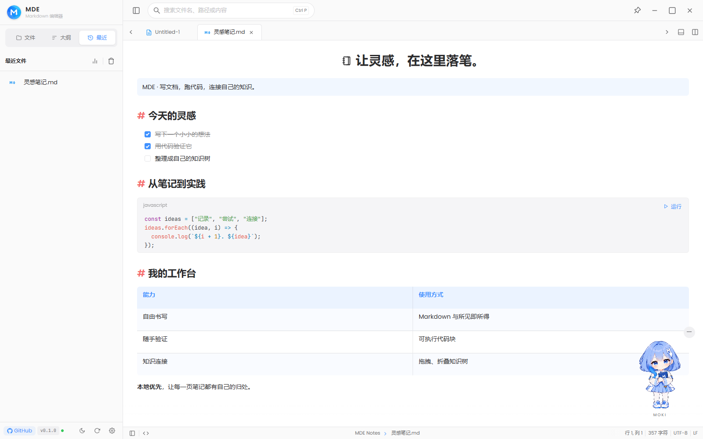
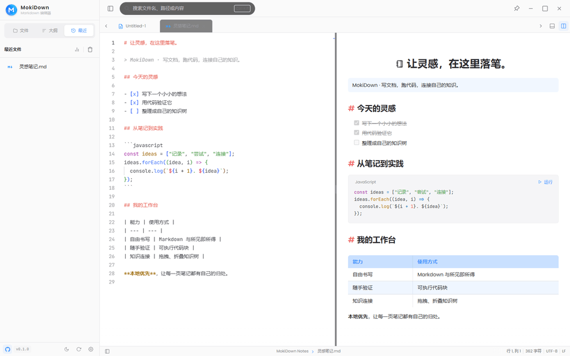

<div align="center">

# MokiDown · Markdown Editor

**写文档 · 跑代码 · 画知识树 · 自托管云同步**

基于 Tauri 2 + React + Monaco + Milkdown 的开源 Notebook 式 Markdown 工作台。
本地优先、所见即所得：文档里的代码块可以直接运行，笔记能画成知识树，数据能同步到你自己的服务器。

[▶ 在线体验（无需下载）](https://www.miaogu.xyz/) · [⬇️ 下载](https://github.com/hhyufan/mde-tauri/releases) · [English](README_EN.md)

      


</div>

---

## ✨ 为什么是 MokiDown

### ⚡ 可执行代码块

文档里的代码块可以直接运行，输出实时流入内置控制台，当前支持 C#、JavaScript、Python、Java、Kotlin、Rust 六种语言。
由 Rust 端执行引擎驱动：支持 stdin 交互、运行取消、超时控制与进程树管理（Windows 侧使用 Job Object），Windows / macOS / Linux 全平台可用。

### 🔌 内置 LSP 语言服务（8 个）

接入本地 stdio 语言服务器，在编辑器里直接获得诊断、悬停提示与补全，配合问题面板统一查看。
内置插件目录共 8 个语言服务：JavaScript & TypeScript、HTML、CSS、Python（Pyright）、C#（Roslyn / csharp-ls）、Kotlin、Java（Eclipse JDT）、Rust（rust-analyzer）。
语言服务以数据驱动的插件包管理，按需安装 / 卸载 / 配置，下载的安装包会做 SHA-256 校验；也可以添加在线插件目录或粘贴自定义 JSON 清单，不依赖任何外部编辑器。

### ✍️ 三种编辑模式，一套编辑器

- **编辑模式**：Monaco Editor（VS Code 同款内核）源码编辑，也是非 Markdown 文件的默认形态
- **预览模式**：Markdown 走 Milkdown 所见即所得，表格 / 图片 / 公式 / 代码块可在渲染态与源码态切换；`.mgtree` 走树编辑器
- **分屏模式**：拖拽调整比例，编辑器与预览滚动联动，预览可跟随缩放；不可预览的文件自动回退到 Monaco

### ☁️ 自托管云同步

内置账号体系（JWT 鉴权）+ 基于 `fileId + rev/baseRev + mutation queue` 的增量同步引擎。
支持 `cloud://` 云文档、设置同步、冲突双栏对比（保留本地或采用远端），服务端开源，可一键部署到自己控制的服务器（Vercel / Docker / 本地）。

### 🌳 树编辑器（mgtree）

用缩进语法把知识脉络画成树，节点可拖拽、折叠、增删；`.mgtree` 在文件树里使用专属的多色树形图标。通过 `>语言[序号]` 跳转语法从树节点**精确定位到文档中的代码块**，跳转后目标代码块高亮提示。

---

## 🧭 设计原则

MokiDown 的能力来自四个明确的取舍——也是[官网](https://www.miaogu.xyz/)介绍页的四条主线：

- **本地优先**：默认直接读写本地文件，数据始终是你自己的，不锁格式、不强制登录
- **可选同步**：登录后文档与设置才进入增量同步；冲突明确展示，**从不在后台替你覆盖**
- **按需载入**：Monaco / Milkdown / Mermaid 等重型模块只在需要时加载，启动路径保持简洁
- **所见即所得与源码并存**：写作时排版即所得，需要源码随时切回 Monaco 或分屏

---

## 📸 界面截图

| 晴笺 · 浅色欢迎页 | 夜读 · 深色欢迎页 |
| :---: | :---: |
|  |  |

| 三模式编辑（编辑 / 预览 / 分屏） | 代码块运行 |
| :---: | :---: |
|  |  |

| 云同步冲突 | 树编辑器（.mgtree） |
| :---: | :---: |
|  |  |

| 深色编辑 | 外观与角色设置 |
| :---: | :---: |
|  |  |

| 所见即所得（Milkdown） | 模式切换演示 |
| :---: | :---: |
|  |  |

截图来自运行中的实际界面，使用示例文档；代码输出和同步冲突使用演示数据展示真实组件，不代表浏览器可启动桌面执行引擎或已连接同步服务。[移动端欢迎页](screenshots/welcome-mobile.png) · [设计与截图说明](docs/character-design/moki-integration.md)

### Moki · 墨笺，欢迎页形象

Moki 以蓝色短发、M↓ 发饰和笔记本延续产品形象。半身构图突出面部，适合欢迎页及小尺寸主题卡片；浅色版挥手开怀笑，搭配纸白服装与太阳书扣；深色版托腮眯眼夜读，搭配墨蓝服装与月牙书扣。

- 欢迎页保持精简：品牌行 + 一句主标题 + 「从一个小任务开始」的三张任务卡（新建文档 / 打开文件 / 打开文件夹），下方接着最近文档。
- 空状态（文件树 / 大纲 / 最近 / 搜索）共用统一组件：人物立绘 + 一句简短主句 + 底部一行平实提示。
- 设置 → 外观是两张主题卡（浅色「晴笺 · 浅色」、深色「夜读 · 深色」）加一个「人物显示」开关；关闭人物后主题切换变为不含人物的紧凑卡片，欢迎页与关于页也不再显示人物。
- 关于页是一张卡片：人物 + 品牌 + 版本 + 作者 + 仓库入口 + Star 提示，版本号只出现一次。
- 编辑区不显示人物，保留完整的编辑和滚动空间；人物动效遵从系统减少动态效果偏好。

---

## 🚀 功能总览

### 编辑与预览

- 三种视图模式：编辑（Monaco 源码）/ 预览（Markdown 走 Milkdown 所见即所得，`.mgtree` 走树编辑器）/ 分屏（Monaco + 只读预览）；不可预览的文件自动回退到 Monaco
- 浮动工具栏：粗体、斜体、删除线、标题、引用、表格、代码块、链接、图片、任务列表、分隔线快捷插入
- 大纲面板联动：标题与列表结构同步到大纲，点击跳转编辑区或预览区

### Markdown 能力

- GFM：表格、任务列表（可点击切换）、删除线、脚注
- LaTeX 数学公式、Mermaid 图表渲染
- 代码块语言标识、高亮与一键复制
- 相对链接应用内打开，`#Lxx` / `Lxx~xx` 行号提示与跳转

### 文件与工作区

- 资源管理器：目录浏览、面包屑、前进 / 后退 / 上一级、刷新、排序、关闭目录
- 多标签页：新建、切换、重命名、未保存状态提示；新建 / 打开 / 保存 / 另存为 / 重命名 / 删除
- 最近文件 / 书签 / 云文档统一聚合入口
- 拖拽交互：拖入编辑区直接打开，拖入资源管理器移动到当前目录
- 系统联动：在系统文件管理器中定位当前文件或目录

### 搜索与统计

- `Ctrl + P` 全局搜索：文件名搜索 + Markdown 内容搜索，命中行定位跳转
- 统计面板：打开文件数、最近文件数、字数 / 字符数、文件类型分布

### 云同步（文档 + 设置）

本地文件默认只存在于你的磁盘上；登录并绑定后，文档与设置才进入增量同步。

- 注册 / 登录 / JWT 鉴权
- 增量同步引擎：`fileId + rev/baseRev + mutation queue`，SHA-256 完整性校验、自动重试、并发拉取
- 绑定策略：本地文件收藏或绑定 `fileId` 后参与同步；支持 `cloud://<fileId>` 仅云端文档
- 冲突处理：双栏对比，保留本地或采用远端
- 设置同步与 JSON 导入 / 导出

### 个性化与体验

- 设置页分组：通用 / 外观 / 编辑器 / 语言服务 / 云同步 / 关于
- 明暗主题切换（带过渡动画）、中英双语界面（i18next）
- 自动保存、关闭前未保存文件勾选保护、Toast + Notification 双通道通知
- 自定义标题栏、窗口控制、桌面 / 移动端自适应布局

### 跨平台

| 平台 | 产物 |
| --- | --- |
| Windows | EXE 安装包（NSIS）/ MSI |
| macOS | Apple Silicon / Intel DMG |
| Linux | deb / rpm / AppImage |
| Android | APK（SAF 文件访问适配、窄屏抽屉布局、移动端选择条） |

### 工程质量

- 48 个单元 / 组件测试文件（Vitest + Testing Library）；CI 覆盖前端 lint / test / format / build / 体积预算与 Rust fmt / clippy / test
- 冷启动优化：发布配置 fat LTO + panic=abort + 符号剥离，前端重型模块按需懒加载
- 打包体积预算检查、版本号同步脚本、MSVC 构建环境检测
- Release 流水线：Windows 侧产出 NSIS + MSI，并对齐代码签名校验

---

## ⌨️ 常用快捷键

| 快捷键 | 功能 |
| --- | --- |
| `Ctrl + P` | 文件 / 内容搜索 |
| `Ctrl + S` | 保存当前文件 |
| `Ctrl + O` | 打开文件或目录 |
| `Ctrl + J` | 呼出 / 收起输出控制台 |
| `Ctrl + Shift + M` | 打开问题面板 |
| `F5` | 运行当前文件 |
| `Shift + F5` | 停止运行 |
| `Ctrl + ,` | 打开设置 |
| `Ctrl + B` | 切换侧栏 |
| `Ctrl + Shift + /` | 编辑 / 预览模式切换 |
| `Esc` | 关闭搜索 / 设置 / 登录弹窗 |

---

## 📦 安装

前往 [Releases](https://github.com/hhyufan/mde-tauri/releases) 下载对应平台版本。

- **Windows**：推荐 EXE 安装包（NSIS）；MSI 适合系统集成
- **macOS**：按芯片选择 Apple Silicon 或 Intel 版本
- **Linux**：Ubuntu/Debian 用 `.deb`，Fedora 系用 `.rpm`，其余发行版用 `.AppImage`
- **Android**：安装 APK（首次构建见下方说明）

---

## 🛠 技术栈

| 层级 | 技术 |
| --- | --- |
| 桌面壳 | Tauri 2（Rust） |
| 前端 | React 18 + Ant Design 5 + Zustand |
| 编辑器 | Monaco Editor + Milkdown |
| 代码执行 / LSP | Rust 执行引擎 + 语言服务插件包系统 + 本地 stdio 语言服务器 |
| Markdown 渲染 | react-markdown + remark-gfm + remark-math + rehype-katex + rehype-sanitize |
| 图表 / 高亮 | Mermaid + Prism / Shiki |
| 国际化 | i18next + react-i18next |
| 构建 | Vite 6 + Tauri CLI 2 |
| 服务端 | NestJS 10 + Mongoose 8 + MongoDB + JWT（Passport） |

---

## 📂 项目结构

```text
mde-tauri/
├── src/                      # React 前端源码
│   ├── components/           # 编辑器、布局、弹窗、UI 组件
│   │   ├── editor/           # Monaco / Milkdown / 树编辑器 / 控制台与问题面板
│   │   ├── moki/             # 人物立绘、主题卡、欢迎页、统一空状态
│   │   └── overlays/         # 设置、语言服务、登录、冲突等弹窗
│   ├── configs/              # 语言服务清单与扩展名 → 语言映射
│   ├── hooks/                # 文件管理、buffer 等业务 hooks
│   ├── services/             # API 客户端、同步引擎、LSP 客户端、脚本运行
│   ├── store/                # Zustand 状态管理
│   ├── showcase/             # 在线体验用的纯浏览器展示入口（showcase.html）
│   ├── utils/                # 工具函数与 Tauri API 封装
│   └── i18n/                 # 国际化资源
├── src-tauri/                # Rust 侧：命令、脚本执行引擎、LSP、语言插件、打包配置
├── examples/                 # 截图 / 验收用的示例工作区
├── docs/                     # 实现讲解文档（同步、语言服务、脚本运行等）
├── screenshots/              # README 截图素材（PNG / GIF）
└── README.md
```

云同步服务端位于独立仓库：[hhyufan/mde-server](https://github.com/hhyufan/mde-server)。
官网视觉演示：[miaogu.xyz](https://www.miaogu.xyz/)。

---

## 🧪 示例工作区（examples/）

`examples/` 是截图与手动验收用的示例工作区：每个已接入的语言服务都有一个最简源码文件，另有 `notes/`、`web/` 两个子目录用于展示目录树的展开与折叠。

| 路径 | 语言 / 能力 | 语言服务 |
| --- | --- | --- |
| `hello.ts` · `utils.js` | JavaScript / TypeScript（接口 + 类 + 泛型；多后缀） | mde.typescript |
| `hello.py` | Python（dataclass + 类型标注） | mde.pyright |
| `hello.rs` | Rust（struct + impl） | mde.rust |
| `Hello.java` | Java（record + stream） | mde.java |
| `Hello.cs` | C#（record + LINQ） | mde.csharp |
| `Hello.kt` | Kotlin（data class + 扩展函数） | mde.kotlin |
| `feature-tour.md` | Markdown 渲染一览（标题 / 表格 / 任务列表 / 引用） | — |
| `web/index.html` · `web/styles.css` | HTML / CSS 成对示例 | mde.html · mde.css |
| `notes/code-lab.md` | 可直接运行的代码块 | 内置控制台 |
| `notes/knowledge-tree.mgtree` | 树文件（缩进即层级） | 编辑器内置树视图 |
| `notes/shortcuts.md` | 常用快捷键备忘 | — |

语言服务插件的 ID 沿用远端服务的既有标识（形如 `mde.*`），此处原样保留。
维护约定：所有示例文件保持可直接运行、无诊断错误；新增语言服务时在外层补一个同名示例文件，并同步更新上表。完整说明见 [examples/README.md](examples/README.md)。

---

## 🧑‍💻 开发

### 环境要求

| 工具 | 版本 | 说明 |
| --- | --- | --- |
| Node.js | 18+ | 前端依赖（CI 使用 Node 22） |
| Rust | 1.77+ | Tauri 编译 |
| JDK | 17–21 | Android 构建 |
| WebView2 | Win10+ 自带 | Windows 运行环境 |

### 常用脚本

| 命令 | 作用 |
| --- | --- |
| `npm run dev` | 仅前端开发服务器（浏览器调试） |
| `npm run tauri:dev` | 前端 + Rust 桌面端 |
| `npm run build` | 前端构建（`index.html` 与 `showcase.html` 两个入口） |
| `npm run tauri:build` | 打包桌面端（默认 NSIS + MSI） |
| `npm run tauri:build:nsis` | 只产出 NSIS 安装包 |
| `npm run test` / `npm run test:watch` | Vitest 单元与组件测试 |
| `npm run lint` / `npm run format:check` | ESLint / Prettier 检查 |
| `npm run check:bundle` | 打包体积预算检查 |
| `npm run version:sync` | 同步 package.json / Cargo.toml / tauri.conf.json 版本号 |
| `npm run check` | lint + test + 构建 + 体积预算一条龙 |

### 启动桌面端

```bash
npm install
npm run tauri:dev      # 前端 + Rust
# 仅前端（浏览器调试）
npm run dev
```

### 构建

```bash
npm run tauri:build    # 产物：src-tauri/target/release/bundle/
```

### 构建 Android APK

安装 Android Studio（SDK / NDK / Build Tools），配置 `JAVA_HOME` 与 `ANDROID_HOME`：

```bash
npm run tauri:android:init
npm run tauri:android:build
```

移动端自动启用窄屏布局；文件访问通过 SAF 适配，部分桌面能力（任意目录浏览、本地脚本执行等）会降级。

---

## ☁️ 云服务（自托管服务端）

云同步依赖独立服务端仓库 [hhyufan/mde-server](https://github.com/hhyufan/mde-server)（NestJS + MongoDB）：

```bash
git clone https://github.com/hhyufan/mde-server.git
cd mde-server
npm install
cp .env.example .env   # 配置 MONGODB_URI / JWT_SECRET
npm run start:dev
```

部署方式：

- **Vercel**：仓库已内置单函数 Serverless 部署（详见 `VERCEL.md`），数据库使用 MongoDB Atlas
- **Docker**：仓库提供 Dockerfile
- **本地 / 自托管**：任意能跑 Node + MongoDB 的服务器

客户端在 设置 → 云同步 中配置服务端地址后即可启用同步。

---

## 🤝 贡献

欢迎提交 PR：

1. Fork 本仓库
2. 创建分支：`git checkout -b feature/xxx`
3. 提交：`git commit -m "feat: xxx"`（建议遵循 [Conventional Commits](https://www.conventionalcommits.org/)）
4. 推送并创建 Pull Request

---

## 📄 许可证

本项目采用 MIT 许可证，详见 [LICENSE](LICENSE)。

---

**MokiDown** — 专注写作，清晰表达。把复杂交给工具。
